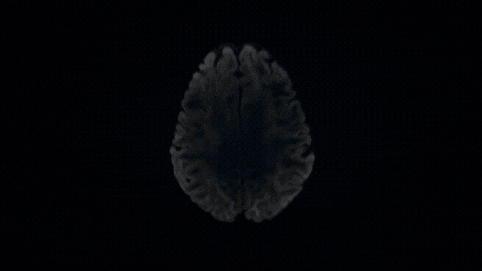

<div align="center">

# SlicerDSpace

**Diffusion MRI anatomical priors, microstructure and connectivity in 3D Slicer**

[](#technology-stack)
[](#installation)
[](#technology-stack)
[](#technology-stack)
[](#technology-stack)
[](#technology-stack)
[](#technology-stack)
[](#technology-stack)
[](#technology-stack)
[](#agent-skills)
[](https://neurodmri.github.io/SlicerDSpace/)
[](LICENSE.txt)

[Overview](#overview) | [Video](#video) | [Technology](#technology-stack) | [Agent Skills](#agent-skills) | [Install](#installation) | [Quick Start](#quick-start) | [CLI](#command-line) | [Documentation](#documentation) | [Citation](#citation) | [中文](README.zh-CN.md)

[Project Website](https://neurodmri.github.io/SlicerDSpace/) | [User Guides](docs/README.md) | [Release Status](#validation-and-release-status)

</div>

SlicerDSpace combines T1-weighted-image-free anatomical reconstruction,
microstructural mapping and white-matter analysis in one 3D Slicer module.
Choose your methods, prepare their environment and inspect the results in the
same scene.

---

<a id="video"></a>

<p align="center">
  <picture>
    <source media="(prefers-color-scheme: dark)" srcset="docs/site/assets/img/slicerdspace-wordmark-light.svg">
    <source media="(prefers-color-scheme: light)" srcset="docs/site/assets/img/slicerdspace-wordmark.svg">
    
  </picture>
</p>

<a href="docs/site/media/SlicerDSpace_promo_1080p.mp4">
  
</a>

[Watch the full video (MP4, 1:05)](docs/site/media/SlicerDSpace_promo_1080p.mp4) ·
[Website player](https://neurodmri.github.io/SlicerDSpace/#film)

---

## Overview

| Workflow | Methods and products |
| --- | --- |
| Input preparation | DICOM, NIfTI and NRRD/NHDR import; gradient checks, brain masking and optional DWI correction |
| Microstructure | DTI FA/MD/AD/RD and a colour FA map; optional Free-water, iFW, NODDI and DKI (Python MK-Curve by default) |
| Anatomical prior | DDSeg tissue labels, DDParcel regions, DDSurfer white/pial surfaces; optional cortical postprocessing |
| Tractography | DTI deterministic, UKF, CSD/ACT with SIFT2, and SAF short association fibres |
| Fiber bundles | Official WMQL queries, WMA atlas classification and TractCloud |
| Connectome | Streamline-count and scalar-weighted matrices; eligible SIFT2-weighted connectivity |

Key products load into Slicer as successful stages finish. Run-scoped loading
reuses scene nodes, while logs, parameters and QC stay with each run.
Optional [regional analysis](docs/setup/REGIONAL_ANALYSIS.md) reuses completed
maps, full tractograms and matrices for selected DDParcel regions. Search by
region name or label ID for scalar/tissue summaries, cortical morphology,
A-to-B streamline selection and regional connectivity. Detailed options stay
collapsed; reports and cohort CSV templates are included.

Shared preparation and compatible cached outputs are reused. Independent
microstructure models and separate subjects can run concurrently within the
configured resource budget. See [experiments](docs/setup/EXPERIMENTS.md) and
[measured optimizations](docs/release/PERFORMANCE_OPTIMIZATIONS.md).

---

## Technology Stack

| Layer | Components | Role |
| --- | --- | --- |
| Slicer interface | 3D Slicer, Qt/PythonQt, CTK, MRML | Product selection, native scene loading and result review |
| Scientific Python | Python, NumPy, SciPy, nibabel, SimpleITK | Images, geometry, numerical fitting and data exchange |
| Neural inference | PyTorch, DDSeg/DDParcel/DDSurfer models | Tissue, regional and surface reconstruction |
| Microstructure | DIPY, AMICO, Python MK-Curve | Tensor, free-water, neurite and kurtosis models |
| Diffusion tools | Teem tensor fit (Slicer core); optional UKFTractography, MRtrix3, FSL and SlicerDMRI | DTI fit, tracking and selected correction routes |
| Optional backends | PNL CNN/ANTs, native FreeSurfer components, WMQL, WMA, TractCloud | Masking, cortical postprocessing and bundle identification |
| Automation | Python CLI, JSON run plans, batch runner, Agent Skill | Reproducible commands, parameter variants and cohort scheduling |

Unified one-click setup archives and standalone OS Base packages are self-contained (`depends NA`) and already bundle Python 3.12 (including **PyTorch** and `torchvision`), core model weights, `UKFTractography`, and native `MRtrix3`/`FSL`/`FreeSurfer Surface Runtime` binaries—no separate Slicer PyTorch or SlicerDMRI extension install is needed. For source-staged or modular installs, dependencies follow the selected route: DTI fitting runs inside Slicer without extra extensions, CSD/ACT uses MRtrix3, and a DTI-only route with a supplied mask avoids PNL, FSL and FreeSurfer. See the [capability/platform matrix](docs/setup/SUPPORT_MATRIX.md).

**Implementation origins:** DDSeg uses converted Python/PyTorch models; SAF
and MK-Curve are unofficial Python ports of author MATLAB methods. PNL CNN
masking runs a modified copy of the author's PNL inference code (licence
terms in the [PNL licence page](docs/licenses/pnl_brain_mask.md)). Optional surface
postprocessing uses original FreeSurfer components and a personal activation
file. Details: [provenance](docs/architecture/IMPLEMENTATION_PROVENANCE.md) ·
[surface components](docs/setup/SURFACE_COMPONENTS.md).

---

## Agent Skills

Our **install-and-use Agent Skill** guides a local Agent through setup,
analysis and result review.

| Task | What the Skill covers |
| --- | --- |
| Install and enable | Find Slicer, stage the module, verify activation and prepare selected dependencies |
| Plan and run | Prepare inputs, choose algorithms and tracking/bundle sources, review plans and run requested analyses or batch experiments |
| Review and reuse | Inspect outputs, logs and QC; reuse compatible results and preserve unrelated scene nodes |

[Open the Skill](.agents/skills/slicerdspace/SKILL.md) ·
[Agent usage guide](.agents/skills/slicerdspace/references/usage.md) ·
[CLI templates](docs/setup/CLI_TEMPLATES.md) ·
[Algorithm Shell templates](.agents/skills/slicerdspace/references/shell_templates.md)

Prompts link directly to `SKILL.md`, the Agent's entry point. To install the Skill
in an Agent, copy the complete `slicerdspace` directory, including its references,
scripts and templates.

Copy this prompt into your local Agent:

```text
Read https://github.com/NeuroDMRI/SlicerDSpace/blob/main/.agents/skills/slicerdspace/SKILL.md.
Install and enable SlicerDSpace in my local 3D Slicer.
Set up the required dependencies and download the corresponding model weights.
```

The Agent checks storage space and existing resources, waits for your choice,
and saves the selected path for GUI and CLI use. It downloads only the resources
needed by your selected analyses. Repository access is required while it is private;
you can provide an authorized local checkout if the Agent cannot open the URL.
Confirm licenses and restarts when requested.

**Use an existing installation.** Replace the input and output paths in this example:

```text
Read https://github.com/NeuroDMRI/SlicerDSpace/blob/main/.agents/skills/slicerdspace/SKILL.md.
Use SlicerDSpace to run DDParcel brain parcellation, CSD/ACT tractography and structural connectome construction for /path/to/subject; save results to /path/to/results.
Show me the plan and wait for confirmation before running. Afterwards, summarize the outputs and QC findings.
```

Change the requested methods to suit your study; the [usage guide](.agents/skills/slicerdspace/references/usage.md)
and [CLI templates](docs/setup/CLI_TEMPLATES.md) cover other routes and batch execution.

---

## Installation

### Option A: One-Click Graphical Setup Extension (Recommended)

1. **Install 3D Slicer 5.10.0** for Windows (`x86_64`), Linux (`x86_64`) or Apple Silicon macOS (`arm64`) from [download.slicer.org](https://download.slicer.org/).
2. **Customize and download the `~13 KB` setup archive** (`SlicerDSpaceSetup-macOS.zip`, `SlicerDSpaceSetup-Windows.zip` or `SlicerDSpaceSetup-Linux.zip`) on the [SlicerDSpace Project Website](https://neurodmri.github.io/SlicerDSpace/#start) — choose your operating system (`macOS arm64`, `Windows x86_64`, `Linux x86_64`), optional WMA white-matter atlases, and optional **GitHub mirror** (`ghfast.top` / `gh-proxy.com` / custom prefix), **HTTP/HTTPS proxy**, **local offline folder** or **model directory** — or download the universal setup `.zip` directly from [GitHub Releases](https://github.com/NeuroDMRI/SlicerDSpace/releases).
3. **Install in 3D Slicer 5.10.0** via **View > Extensions Manager > top-right wrench icon > Install Extension from File...**, select `SlicerDSpaceSetup-<OS>.zip`, and restart Slicer. After restarting, the **SlicerDSpace Setup** wizard opens automatically; confirm your options and click **Start Install** (12-thread HTTP Range resume; automatically fetches and verifies the NITRC `IITmean_b0_256.nii.gz` template). Once deployment finishes, restart Slicer and open **Modules > Diffusion > SlicerDSpace**.

What is included automatically (no separate Slicer `PyTorch`, `UKFTractography`, or `SlicerDMRI` installation needed):
- **Included Base Package (`~1.4–1.7 GB`, self-contained, `depends NA`)**: SlicerDSpace module, bundled Python 3.12 packages (**including PyTorch and torchvision**), all non-WMA deep-learning weights and templates (`DDSeg`, `DDParcel`, `DDSurfer` + FreeSurfer surface atlas, `PNL` brain mask weights, `TractCloud`), pinned algorithm sources (`WMQL`, `WMA`, `TractCloud`), `UKFTractography` CLI, and native binary runtimes (`MRtrix3 3.0.8`, `FSL 2602.0`, `FreeSurfer Surface Runtime` with `activation_key_included: false` — optional cortical surface postprocessing still requires your own FreeSurfer `license.txt`).
- **Optional WMA White-Matter Atlases**: `ORG` checked by default (`< 2.0 GiB`); large `NABA` (`~3 GB`) and `East-West` (`~10 GB`) unchecked by default. Any omitted atlas (`ORG`, `NABA` or `East-West`) can be hot-downloaded or imported offline later inside Slicer without reinstalling or restarting.

### Option B: Standalone Offline OS Base Package + Optional WMA Atlases

For offline machines or manual installation from [GitHub Releases](https://github.com/NeuroDMRI/SlicerDSpace/releases), download the compact unified **OS Base package** (`~1.4–1.7 GB`) for your platform:

- **Windows (`x86_64`)**: `SlicerDSpace-v0.1.1-Windows-x64.zip`
- **Linux (`x86_64`)**: `SlicerDSpace-v0.1.1-Linux-x64.tar.gz`
- **macOS (Apple Silicon `arm64`)**: `SlicerDSpace-v0.1.1-macOS-arm64.tar.gz`

Install via **View > Extensions Manager > top-right wrench icon > Install Extension from File...** (**do not use GitHub's automatic Source code archive**), restart Slicer and open **Modules > Diffusion > SlicerDSpace**. Each Base package is self-contained (`depends NA`) with bundled Python 3.12 (**PyTorch + torchvision**), core model weights (`DDSeg`, `DDParcel`, `DDSurfer` + `atlas.tar.gz`, `PNL`, `TractCloud`), algorithm sources (`WMQL`, `WMA`, `TractCloud`), `UKFTractography` CLI, and native `MRtrix3`/`FSL`/`FreeSurfer Surface Runtime` binaries verified by per-file `tree_sha256` digests (`activation_key_included: false`, so optional cortical surface postprocessing requires your own FreeSurfer `license.txt`; NITRC `IITmean_b0_256.nii.gz` and the three optional WMA atlases `WMA-ORG.tar.gz`, `WMA-NABA.tar.gz.001`.., `WMA-EastWest.tar.gz.001`.. remain separate).

### Option C: Stage From Source (Developers)

Use an authorized checkout while the repository is private. This lightweight
source installation omits the website and historical reports; a full checkout
retains development tests and research materials.

```bash
git clone --filter=blob:none --no-checkout --depth 1 https://github.com/NeuroDMRI/SlicerDSpace.git
cd SlicerDSpace
git show HEAD:scripts/extension_runtime/runtime_checkout.txt | git sparse-checkout set --no-cone --stdin
git checkout
PythonSlicer scripts/stage_slicer_extension.py \
  --install-root ~/SlicerDSpace-extension --slicer-version Slicer-5.10 \
  --link-mode copy
```

For Slicer 5.10, add the expanded absolute path below in **Edit > Application
Settings > Modules > Additional module paths**, then restart:

```text
~/SlicerDSpace-extension/SlicerDSpace/lib/Slicer-5.10/qt-scripted-modules
```

`--slicer-version` applies to your installed Slicer release. After a source update,
restage the extension and restart Slicer. More options: [download and installation guide](docs/setup/DOWNLOADS.md).

### On-Demand Resources And Source-Staged Environment

**Option A and Option B already bundle PyTorch, Python packages, core weights, `UKFTractography`, and native runtimes** — you do not need to install Slicer's separate PyTorch extension or run **Prepare selected analysis environment** for bundled workflows. Use **Environment and installation > Prepare selected analysis environment** only for source-staged installs (Option C), runtime repair, supplying a FreeSurfer `license.txt`, or adding optional WMA atlases/models on demand.

When triggered, one dialog lists every missing component with its size and licence (name, link and local file); press **Accept licences and install** once, restart if Slicer asks, and select Prepare again to continue. A synthetic self-check runs per feature before it is marked ready. For source-staged installs, Slicer extensions are added only when required (`PyTorch` for neural models and the native brain mask, `UKFTractography` for UKF, and optional `SlicerDMRI`; tensor fitting needs no extension).

Optional weights, templates and atlases reside in [**SlicerDSpace-models**](https://github.com/ChengjinLii/SlicerDSpace-models). Setup verifies SHA256 digests, caches downloads and saves configured paths under **More options**. See [managed setup](docs/setup/MANAGED_SETUP.md) and [resource terms](docs/assets/MODEL_ASSET_TERMS.md).

Without the GUI, run the same setup in Slicer's own `PythonSlicer` (no system Python is needed); the first command inspects the plan and the second installs with licence acceptance:

```bash
PythonSlicer scripts/setup_selected.py --targets microstructure,tractography
PythonSlicer scripts/setup_selected.py --targets microstructure,tractography --execute --accept-licences
```

Self-checks run through `scripts/check_setup_functionality.py`. For explicit CLI model downloads:

```bash
PythonSlicer scripts/download_model_assets.py --profile surface \
  --asset-root ~/SlicerDSpace-model-assets --source url \
  --source-id slicerdsurfer_models_git
```

For all anatomical model groups, use `scripts/download_model_assets.sh --profile core`.
Other profiles and offline import are documented in [model setup](docs/assets/MODEL_ASSETS.md).

---

## Quick Start

1. Open **Modules > Diffusion > SlicerDSpace** and choose English or Chinese.
2. Under **Inputs**, enter **Subject ID** and **Output folder** (outputs write automatically under `<Output folder>/<Subject ID>/`), then drop or browse your DWI data in the **NIfTI / NRRD / DICOM** tabs.
3. Under **Analysis**, tick desired stages (for a quick check, keep only **Microstructure** with **DTI** selected under `...`) and set **Compute device** (`Auto`, `CPU`, `Apple MPS` or `CUDA GPU`).
4. Click **Run SlicerDSpace** (live stage progress and elapsed time appear beneath the button; one-click / base-package installs run directly, while omitted atlases or a one-time FreeSurfer license prompt on demand).
5. Inspect loaded volumes/models in the scene and open **Results** to toggle visibility (eye icon; right-click to unload or open tables/JSON) or click **Open report** for QC summaries under `06_qc/`.

CLI and batch runs use the canonical prepared subject layout below (GUI imports from NIfTI, NRRD/NHDR or DICOM normalize files into this structure automatically):

```text
sub-01/
  input/
    data.nii.gz
    bvals
    bvecs
    nodif_brain_mask.nii.gz   # optional; supply or generate
```

The [first-workflow tutorial](docs/setup/QUICKSTART.md) includes a synthetic installation check.

### Default Methods And Alternatives

| Part | Default | Other choices |
| --- | --- | --- |
| DWI preprocessing (only when ticked) | One route: DIPY MP-PCA denoising, DIPY Gibbs removal, FSL eddy/topup through `dwifslpreproc` (needs MRtrix3, FSL and the FSL licence; a platform with no FSL build does not offer it); needs a phase-encoding direction, typed or read from `input/dwi.json` (most axial clinical DWI: AP) | `--preprocessing-skip-gibbs` skips Gibbs removal; the route, denoise-method and skip-motion options were removed |
| Missing brain mask | PNL diffusion CNN; valid supplied masks are reused | Supplied mask only (`provided`); SynthStrip, MRtrix and DIPY masks were removed |
| Microstructure | DTI | Add Free-water, NODDI, DKI and/or iFW (iFW needs the echo time); DKI uses the Python MK-Curve by default; WLS or OLS are options |
| Tractography | MRtrix3 CSD/ACT | DTI deterministic, UKF, SAF |
| Connectome | `auto`: MRtrix `tck2connectome` for a `.tck` source with a streamline-count metric, Python otherwise | `python` or `mrtrix` |
| Fiber bundles | Official WMQL multi-bundle queries | WMQL subset selection, WMA, TractCloud |

Use **...** beside Microstructure, Tractography and Fiber bundles to select one or
several methods. **Advanced settings** groups masking, model parameters,
performance, regional analysis/input import and experiments. Environment
installation remains separate.

**Platforms.** On Linux the PNL brain mask runs in a managed conda runtime with
ANTs. On macOS and Windows it runs in Slicer's own Python (SimpleITK and PyTorch).
This native route is **experimental**: its masks did not match the Linux route
closely enough on 2 of 24 test cases. The setting is **PNL route** (`auto`,
`managed`, `native`) in Advanced settings or `--pnl-mask-route` on the command
line, and the run record names the route of the mask that was used. On Windows and Apple Silicon (`arm64`) macOS,
SlicerDSpace runs **natively by default without WSL or Docker**: MRtrix3 (`3.0.8`),
FSL (`2602.0`, `topup`/`applytopup`/`eddy_cpu`), FreeSurfer cortical surface
postprocessing (7 commands), WMA, WMQL, TractCloud, brain masking and all Python
microstructure/anatomical stages execute directly in **3D Slicer 5.10.0**
(WSL 2 remains an optional fallback on Windows). See [Windows](docs/setup/WINDOWS.md),
[Windows 5.10.0 Acceptance](docs/release/WINDOWS_NATIVE_ACCEPTANCE_5.10.0.md),
[macOS](docs/setup/MACOS.md) and
[macOS 5.10.0 Acceptance](docs/release/MACOS_NATIVE_ACCEPTANCE_5.10.0.md).

UKF runs automatically through its installed extension and can feed WMA directly.
WMA supports `--wma-atlas org|east-west|naba` (default: `org`), with the same
selector in Advanced settings. [Atlas selection and on-demand resources](docs/setup/WMA_ATLASES.md).
Multiple tracking methods produce separate `<run>__<backend>` variants.
The full quantitative tractogram is retained alongside a capped VTK display preview.

NODDI/DKI require eligible acquisitions. Inspect fit-validity masks, sparse
fiber bundles, alignment and anatomical priors before accepting results. Method details:
[microstructure](docs/setup/MICROSTRUCTURE.md) · [UKF](docs/setup/UKF.md) · [WMQL](docs/setup/WMQL.md).

---

## Command Line

Use Slicer's Python to check a prepared DTI route:

```bash
export SLICER="/path/to/Slicer"
"$SLICER" --launch PythonSlicer shared/run_subject_pipeline_cli.py \
  --no-user-config --strict-environment \
  --subject-root /path/to/sub-01 --subject-id sub-01 \
  --output-root /path/to/analysis/sub-01/dti --run-name dti \
  --targets validation,microstructure --microstructure-stages dti \
  --brain-mask-backend provided --doctor
```

Keep the same arguments and replace `--doctor` with `--plan` to inspect the plan,
then `--execute` to run. This example expects an existing reviewed mask.

The [CLI templates](docs/setup/CLI_TEMPLATES.md) cover imports, masking, anatomical priors,
all microstructure and tracking routes, explicit bundle sources, connectomes,
PowerShell and reports. [Experiments](docs/setup/EXPERIMENTS.md) covers
named parameter variants and concurrent subjects in both CLI and Advanced settings.
Start with one concurrency level and budget combined RAM/VRAM use.

---

## Documentation

| Task | Guide |
| --- | --- |
| First analysis | [Quick Start](docs/setup/QUICKSTART.md) |
| Commands and batch experiments | [CLI templates](docs/setup/CLI_TEMPLATES.md) · [Experiments](docs/setup/EXPERIMENTS.md) · [Example request](docs/setup/examples/dti_experiments.json) |
| Dependencies and platforms | [Support matrix](docs/setup/SUPPORT_MATRIX.md) · [Linux](docs/setup/LINUX_HPC.md) · [Windows](docs/setup/WINDOWS.md) · [macOS](docs/setup/MACOS.md) |
| Models and offline resources | [Assets](docs/assets/MODEL_ASSETS.md) · [Resource policy](docs/assets/EXTERNAL_RESOURCES.md) |
| Results and selected regions | [Result review](docs/setup/GUI_RESULT_REVIEW.md) · [Regional analysis](docs/setup/REGIONAL_ANALYSIS.md) |
| Settings and output layout | [Shared settings](docs/setup/USER_CONFIG.md) · [Output layout](docs/setup/OUTPUT_LAYOUT.md) |
| Developer and release guides | [Repository layout](docs/architecture/REPOSITORY_LAYOUT.md) · [Extension readiness](docs/release/EXTENSION_READINESS.md) |

---

## Validation And Release Status

| Area | Current scope |
| --- | --- |
| Reference environment | Windows (`x86_64`), Linux (`x86_64`), and macOS (Apple Silicon `arm64`) on 3D Slicer 5.10.0 |
| Validation | Recorded Windows, Linux & macOS (`arm64`) Slicer 5.10.0 Extension Manager install, GUI smoke suites, runtime corruption auto-repair, and real-data multi-shell and clinical single-shell workflows |
| Distribution | GitHub Release `v0.1.1` one-click setup archives (`SlicerDSpaceSetup-macOS.zip`, `SlicerDSpaceSetup-Windows.zip`, `SlicerDSpaceSetup-Linux.zip`, customizable via the [Project Website](https://neurodmri.github.io/SlicerDSpace/#start)) and standalone OS Base packages (`SlicerDSpace-v0.1.1-Windows-x64.zip`, `SlicerDSpace-v0.1.1-Linux-x64.tar.gz`, `SlicerDSpace-v0.1.1-macOS-arm64.tar.gz`) + separate WMA atlases; online Extension Catalog listing remains a Tier 1 proposal |
| Licensing | BSD-3-Clause project code; third-party runtimes and on-demand model assets retain separate terms and release gates (FreeSurfer surface postprocessing requires a user-supplied license) |

Execution status, automatic QC and human review are recorded or assessed separately.
Review [validation records](docs/README.md#validation-records),
[platform support](docs/setup/SUPPORT_MATRIX.md) and
[release readiness](docs/release/EXTENSION_READINESS.md) for scope and outstanding checks.
The software is for research use, not clinical diagnosis.

Development checks require a full checkout:

```bash
make test-fast
PythonSlicer scripts/audit_slicer_extension_metadata.py --json
```

Validation is local during development. GitHub Actions and website publication
remain manual-only.

---

## Support

Report the Slicer version, OS, selected methods, failure message and redacted
logs. Remove subject identifiers and private paths before sharing.
Use the [result-review guide](docs/setup/GUI_RESULT_REVIEW.md) for run records
and the [managed-setup guide](docs/setup/MANAGED_SETUP.md) for dependency repair.

---

## Citation

Cite the software version through [CITATION.cff](CITATION.cff) and the methods
used in your analysis: [DDSurfer](https://doi.org/10.1002/advs.76596),
[DDSeg](https://doi.org/10.1016/j.neuroimage.2021.117934) and
[DDParcel](https://doi.org/10.1109/TMI.2023.3331691).
Additional integrated methods are listed in the [website bibliography](https://neurodmri.github.io/SlicerDSpace/#cite).
The SlicerDSpace protocol manuscript is in preparation.

---

## License

Project code: **BSD-3-Clause**, [LICENSE.txt](LICENSE.txt).
Bundled components retain the terms in [THIRD_PARTY_NOTICES.md](THIRD_PARTY_NOTICES.md).
Weights, templates and subject data are governed separately; review
[asset permissions](docs/assets/MODEL_ASSET_TERMS.md) before redistribution.
