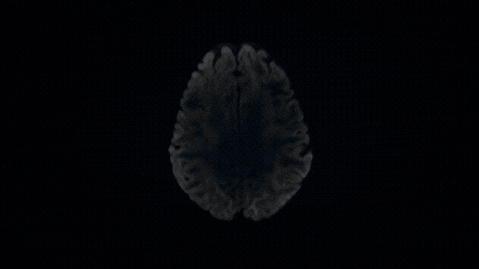

<div align="center">

# SlicerDSpace

**3D Slicer 中的扩散 MRI 解剖、微结构与连接分析**

[](#技术栈)
[](#安装)
[](#技术栈)
[](#技术栈)
[](#技术栈)
[](#技术栈)
[](#技术栈)
[](#技术栈)
[](#技术栈)
[](#agent-skills)
[](https://neurodmri.github.io/SlicerDSpace/)
[](LICENSE.txt)

[概览](#概览) | [宣传视频](#宣传视频) | [技术栈](#技术栈) | [Agent Skills](#agent-skills) | [安装](#安装) | [快速开始](#快速开始) | [CLI](#命令行) | [文档](#文档) | [引用](#引用) | [English](README.md)

[项目网站](https://neurodmri.github.io/SlicerDSpace/) | [使用指南](docs/README.zh-CN.md) | [发布状态](#验证与发布状态)

</div>

SlicerDSpace 将无需 T1 加权影像的解剖重建、微结构定量和白质分析整合到
一个 3D Slicer 模块中。选择算法、准备所需环境，即可在同一场景检查结果。

---

<a id="宣传视频"></a>

<p align="center">
  <picture>
    <source media="(prefers-color-scheme: dark)" srcset="docs/site/assets/img/slicerdspace-wordmark-light.svg">
    <source media="(prefers-color-scheme: light)" srcset="docs/site/assets/img/slicerdspace-wordmark.svg">
    
  </picture>
</p>

<a href="docs/site/media/SlicerDSpace_promo_1080p.mp4">
  
</a>

[观看完整视频（MP4，1 分 05 秒）](docs/site/media/SlicerDSpace_promo_1080p.mp4) ·
[网页播放器](https://neurodmri.github.io/SlicerDSpace/#film)

---

## 概览

| 工作流 | 方法与结果 |
| --- | --- |
| 输入准备 | DICOM、NIfTI、NRRD/NHDR 导入；梯度检查、脑掩膜及可选 DWI 校正 |
| 微结构 | DTI FA/MD/AD/RD 及彩色 FA 图；可选 Free-water、iFW、NODDI、DKI（默认 Python MK-Curve） |
| 解剖重建 | DDSeg 组织分割、DDParcel 脑区、DDSurfer 白质/软脑膜表面及可选皮层后处理 |
| 纤维追踪 | DTI 确定性追踪、UKF、CSD/ACT 与 SIFT2、SAF 短程联络纤维 |
| 束分析 | 官方 WMQL 查询、WMA 图谱分类、TractCloud |
| 连接组 | 流线计数、标量加权矩阵及适用的 SIFT2 加权连接 |

成功阶段的关键结果自动加载到 Slicer，重复加载复用相应节点；
每次运行分别保存日志、参数与 QC。[可选脑区分析](docs/setup/REGIONAL_ANALYSIS.zh-CN.md)
支持按名称或标签号选择脑区，复用已有结果开展微结构、组织构成、皮层形态、A↔B 流线和连接分析。
默认折叠详细选项，提供离线联合报告和多被试 CSV 汇总模板。

共用准备步骤与匹配的缓存可复用；算力允许时，可并发运行独立微结构模型或不同被试。
详见[批量实验](docs/setup/EXPERIMENTS.zh-CN.md)与[性能优化实测](docs/release/PERFORMANCE_OPTIMIZATIONS.zh-CN.md)。

---

## 技术栈

| 层次 | 组件 | 用途 |
| --- | --- | --- |
| Slicer 界面 | 3D Slicer、Qt/PythonQt、CTK、MRML | 算法选择、原生场景加载与结果检查 |
| 科学计算 | Python、NumPy、SciPy、nibabel、SimpleITK | 影像、几何、数值拟合与数据交换 |
| 神经网络推理 | PyTorch、DDSeg/DDParcel/DDSurfer 模型 | 组织、脑区与皮层表面重建 |
| 微结构 | DIPY、AMICO、Python MK-Curve | 张量、自由水、神经突和峰度模型 |
| 扩散工具 | Teem 张量拟合（Slicer 内核）；可选 UKFTractography、MRtrix3、FSL 与 SlicerDMRI | DTI 拟合、追踪及相应校正路线 |
| 可选后端 | PNL CNN/ANTs、原生 FreeSurfer 组件、WMQL、WMA、TractCloud | 掩膜、皮层后处理与束识别 |
| 自动化 | Python CLI、JSON 运行计划、批量调度器、Agent Skill | 命令执行、参数组合及多被试调度 |

通过官网一键引导包或离线底座包安装时，插件本体已自包含（`depends NA`）Python 3.12 依赖库（含 **PyTorch** 与 `torchvision`）、核心模型权重、`UKFTractography` 及 `MRtrix3`/`FSL`/`FreeSurfer Surface Runtime` 三大原生运行环境，**无需用户单独安装 Slicer 的 PyTorch 扩展或 SlicerDMRI**。仅在源码部署或按需拆分环境下，依赖随所选路线解析：DTI 拟合在 Slicer 内直接完成，默认 CSD/ACT 需要 MRtrix3，提供已有掩膜的 DTI-only 路线无需 PNL、FSL 或 FreeSurfer。详见[能力与平台矩阵](docs/setup/SUPPORT_MATRIX.zh-CN.md)。

**实现来源：** DDSeg 使用转换后的 Python/PyTorch 模型；SAF、MK-Curve 为作者
MATLAB 方法的非官方 Python 移植；PNL CNN 掩膜运行作者 PNL 推理代码的修改副本（许可条款见 [PNL 许可页](docs/licenses/pnl_brain_mask.md)）。
可选皮层后处理使用原生 FreeSurfer 组件及个人激活文件。
详见[实现来源](docs/architecture/IMPLEMENTATION_PROVENANCE.zh-CN.md)与[表面组件](docs/setup/SURFACE_COMPONENTS.zh-CN.md)。

---

## Agent Skills

我们提供 **安装与使用 Agent Skill**，让本地 Agent 按项目指南完成配置、分析和结果检查。

| 任务 | Skill 覆盖内容 |
| --- | --- |
| 安装与启用 | 定位 Slicer、部署插件、验证启用并准备所选依赖 |
| 规划与运行 | 准备输入、选择算法及追踪/束来源、检查计划，按请求执行分析或批量实验 |
| 检查与复用 | 检查输出、日志与 QC，复用匹配结果并保留无关场景节点 |

[查看 Skill](.agents/skills/slicerdspace/SKILL.md) ·
[Agent 使用指南](.agents/skills/slicerdspace/references/usage.md) ·
[命令行模板](docs/setup/CLI_TEMPLATES.zh-CN.md) ·
[各算法 Shell 模板](.agents/skills/slicerdspace/references/shell_templates.md)

Prompt 直接链接到入口文件 `SKILL.md`。如果要把 Skill 安装进自己的 Agent，
应复制完整的 `slicerdspace` 文件夹，保留其中的指南、脚本和模板。

将下面的 Prompt 直接发给自己的本地 Agent：

```text
参考 https://github.com/NeuroDMRI/SlicerDSpace/blob/main/.agents/skills/slicerdspace/SKILL.md，
帮我把 SlicerDSpace 安装并启用到本机的 3D Slicer 中，
配置需要的依赖环境，并下载相应模型权重。
```

Agent 会检查可用空间和已有资源，等你选择后再下载，并保存路径供 GUI 和 CLI 共用。
只下载所选分析需要的资源。如果当前网络无法直连 GitHub，可配置镜像、代理或提供本地源码/离线包目录。许可证和重启按提示确认。

**已安装后的使用示例。** 将输入和输出路径替换为本机的实际路径：

```text
参考 https://github.com/NeuroDMRI/SlicerDSpace/blob/main/.agents/skills/slicerdspace/SKILL.md，
使用 SlicerDSpace 对 /path/to/subject 运行 DDParcel 脑区分区、CSD/ACT 纤维追踪和结构连接组构建，结果保存到 /path/to/results。
先给我查看计划，确认后再运行；完成后汇总输出和 QC 检查结果。
```

可按研究需求修改所选方法；其他路线和批处理见 [Agent 使用指南](.agents/skills/slicerdspace/references/usage.md)
及[命令行模板](docs/setup/CLI_TEMPLATES.zh-CN.md)。

---

## 安装

### 方式一：一键图形化安装引导扩展（官网定制或 Release 直下，推荐）

1. **安装 3D Slicer 5.10.0**：从 [download.slicer.org](https://download.slicer.org/) 下载并安装对应平台（Windows `x86_64`、Linux `x86_64` 或 Apple Silicon macOS `arm64`）的 3D Slicer 5.10.0。
2. **定制并下载约 `13 KB` 的一键引导安装包**（`SlicerDSpaceSetup-macOS.zip`、`SlicerDSpaceSetup-Windows.zip` 或 `SlicerDSpaceSetup-Linux.zip`）：在 [SlicerDSpace 官网安装向导](https://neurodmri.github.io/SlicerDSpace/#start) 依次选择操作系统（`macOS arm64`、`Windows x86_64`、`Linux x86_64`）、按需勾选 WMA 白质纤维图谱，以及可选的 **GitHub 下载加速镜像**（`ghfast.top` / `gh-proxy.com` / 自定义前缀）、**HTTP/HTTPS 代理**、**本地离线包目录** 或 **模型保存目录**；也可直接前往 [GitHub Releases](https://github.com/NeuroDMRI/SlicerDSpace/releases) 下载通用 `.zip` 引导包。
3. **在 3D Slicer 5.10.0 中安装并启动**：打开 **View > Extensions Manager > 右上角小扳手 > Install Extension from File...**，选中 `SlicerDSpaceSetup-<OS>.zip` 后重启 Slicer。重启后会自动弹出 **SlicerDSpace Setup** 图形安装窗口，核对配置后点击 **`Start Install`**（支持 12 线程 HTTP Range 分片并发加速与断点续传，并自动拉取、校验 NITRC `IITmean_b0_256.nii.gz` 模板）；部署完成后再次重启 Slicer，在顶部打开 **Modules > Diffusion > SlicerDSpace** 即可使用。

默认自动包含以下完整内容（**无需单独安装 Slicer PyTorch、UKFTractography 或 SlicerDMRI 扩展**）：
- **Included Base Package（约 `1.4–1.7 GB`，内置自包含，`depends NA`）**：包含 SlicerDSpace 主模块、Python 3.12 依赖库（**内置 PyTorch 与 torchvision**）、全部非 WMA 深度学习权重与模板（`DDSeg`、`DDParcel`、`DDSurfer` + FreeSurfer 表面图谱、`PNL` 脑掩膜权重、`TractCloud`）、锁定版本的算法源码（`WMQL`、`WMA`、`TractCloud`）、`UKFTractography` CLI 以及三大原生二进制运行环境（`MRtrix3 3.0.8`、`FSL 2602.0`、`FreeSurfer Surface Runtime`，其中 `activation_key_included: false`，可选皮层表面后处理仍需用户自备个人 FreeSurfer `license.txt`）。
- **Optional WMA White-Matter Atlases（按需勾选）**：默认仅勾选 **`ORG` 图谱**（单包 `< 2.0 GiB`），超大的 **`NABA`**（`~3 GB`）与 **`East-West`**（`~10 GB`）默认不勾选。后续在 Slicer 内切换使用未装的 WMA 图谱时，界面会直接弹出**一键热下载或本地目录导入**窗口，无需重装扩展或重启 Slicer。

### 方式二：离线分平台底座包 + 独立 WMA 图谱包

适合完全离线环境或手动安装。从 [GitHub Releases](https://github.com/NeuroDMRI/SlicerDSpace/releases) 下载对应系统的统一底座包（约 `1.4–1.7 GB`）：

- **Windows (`x86_64`)**：`SlicerDSpace-v0.1.1-Windows-x64.zip`
- **Linux (`x86_64`)**：`SlicerDSpace-v0.1.1-Linux-x64.tar.gz`
- **macOS (Apple Silicon `arm64`)**：`SlicerDSpace-v0.1.1-macOS-arm64.tar.gz`

在 **3D Slicer 5.10.0** 中通过 **View > Extensions Manager > 右上角小扳手 > Install Extension from File...** 导入并重启 Slicer（**请勿使用 GitHub 自动生成的 Source code 源码归档**），打开 **Modules > Diffusion > SlicerDSpace** 即可直接运行除 WMA 图谱外的全部流程。各底座包已自包含（`depends NA`）Python 3.12 依赖（含 **PyTorch + torchvision**）、非 WMA 核心模型权重（`DDSeg`、`DDParcel`、`DDSurfer` + `atlas.tar.gz`、`PNL`、`TractCloud`）、算法源码、`UKFTractography` CLI 及经过 `tree_sha256` 校验的原生 `MRtrix3`/`FSL`/`FreeSurfer Surface Runtime` 运行包（可选皮层表面后处理仍需用户自备 FreeSurfer `license.txt`；NITRC `IITmean_b0_256.nii.gz` 与三套独立 WMA 图谱 `WMA-ORG.tar.gz`、`WMA-NABA.tar.gz.001`..、`WMA-EastWest.tar.gz.001`.. 需按需单独获取）。

### 方式三：从源码部署插件（开发者）

以下轻量源码安装不下载网站和历史报告；
开发测试与科研材料保留在完整仓库中。

```bash
git clone --filter=blob:none --no-checkout --depth 1 https://github.com/NeuroDMRI/SlicerDSpace.git
cd SlicerDSpace
git show HEAD:scripts/extension_runtime/runtime_checkout.txt | git sparse-checkout set --no-cone --stdin
git checkout
PythonSlicer scripts/stage_slicer_extension.py \
  --install-root ~/SlicerDSpace-extension --slicer-version Slicer-5.10 \
  --link-mode copy
```

Slicer 5.10 用户在 **Edit > Application Settings > Modules > Additional module paths**
中加入以下路径（展开为绝对路径），然后重启：

```text
~/SlicerDSpace-extension/SlicerDSpace/lib/Slicer-5.10/qt-scripted-modules
```

`--slicer-version` 应与实际安装版本一致。更新源码后重新部署并重启 Slicer。
其他下载方式见[安装指南](docs/setup/DOWNLOADS.zh-CN.md)。

### 按需资源与源码部署环境准备

**采用方式一或方式二安装时，插件已内置 PyTorch、Python 依赖、核心权重、`UKFTractography` 及原生运行包**——用户无需手动安装 Slicer 的 PyTorch 扩展，也无需预先运行“准备所选分析环境”。仅当从源码部署（方式三）、修复损坏运行包、导入 FreeSurfer `license.txt` 或按需补装可选 WMA 图谱/模型时，才会用到 **环境与安装 > 准备所选分析环境**。

触发后，弹窗会一次性列出缺失项的体积与许可（名称、链接和本地文件），点击一次 **接受许可并安装**，按提示重启并再次准备即可；安装结束会自动以合成数据自检。对于源码部署，插件按实际勾选流程按需安装缺失的扩展（神经网络模型与 native 脑掩膜需要 PyTorch，UKF 需要 UKFTractography，SlicerDMRI 按需可选；张量拟合不需要额外扩展）。

可选权重、模板与图谱存放在 [**SlicerDSpace-models**](https://github.com/ChengjinLii/SlicerDSpace-models)。配置流程会校验 SHA256、缓存下载并在 **更多选项** 中保存路径；详见[自动配置](docs/setup/MANAGED_SETUP.zh-CN.md)与[资源条款](docs/assets/MODEL_ASSET_TERMS.md)。

不使用图形界面时，也可直接在 Slicer 自带的 `PythonSlicer` 中完成上述按需准备（无需系统 Python）：

```bash
PythonSlicer scripts/setup_selected.py --targets microstructure,tractography
PythonSlicer scripts/setup_selected.py --targets microstructure,tractography --execute --accept-licences
```

自检通过 `scripts/check_setup_functionality.py` 运行；如需命令行显式拉取表面模型资源：

```bash
PythonSlicer scripts/download_model_assets.py --profile surface \
  --asset-root ~/SlicerDSpace-model-assets --source url \
  --source-id slicerdsurfer_models_git
```

全套解剖模型资源可用 `scripts/download_model_assets.sh --profile core`。
其他 profile 及离线导入见[模型资源](docs/assets/MODEL_ASSETS.md)。

---

## 快速开始

1. 打开 **Modules > Diffusion > SlicerDSpace**，在顶部切换中文或英文。
2. 在 **Inputs** 中填写 **Subject ID** 与 **Output folder**（分析结果将自动写入 `<Output folder>/<Subject ID>/`），然后在 **NIfTI / NRRD / DICOM** 标签页拖入或浏览选择 DWI 影像数据。
3. 在 **Analysis** 中勾选所需分析阶段（首次快速验证可仅保留 **Microstructure › DTI**；点击阶段旁 `...` 可选具体算法），并选择 **Compute device**（`Auto`、`CPU`、`Apple MPS` 或 `CUDA GPU`）。
4. 点击 **Run SlicerDSpace**（按钮下方实时显示阶段进度与耗时；一键包/底座包可直接使用，若缺少可选图谱或首次使用皮层后处理会按需提示补充或导入 FreeSurfer 许可）。
5. 在场景中检查自动加载的影像与模型，并在 **Results** 面板通过眼睛图标控制显隐（右键可卸载或查看统计表/JSON），点击 **Open report** 查看 `06_qc/` 下的 QC 总结报告。

命令行与队列批处理使用如下标准准备好的被试目录结构（图形界面导入 NIfTI、NRRD/NHDR 或 DICOM 时会自动整理成该结构）：

```text
sub-01/
  input/
    data.nii.gz
    bvals
    bvecs
    nodif_brain_mask.nii.gz   # 可选；自行提供或生成
```

[首次工作流教程](docs/setup/QUICKSTART.zh-CN.md)另含合成安装测试。

### 默认方法与替代选项

| 部分 | 默认 | 其他选项 |
| --- | --- | --- |
| DWI 预处理（仅在勾选时） | 唯一路线：DIPY MP-PCA 去噪、DIPY Gibbs 去除、通过 `dwifslpreproc` 运行 FSL eddy/topup（需要 MRtrix3、FSL 和 FSL 许可；没有 FSL 构建的平台不提供）；需要相位编码方向，手动输入或取自 `input/dwi.json`（大多数轴位临床 DWI 为 AP） | `--preprocessing-skip-gibbs` 跳过 Gibbs 去除；路线、去噪方法和跳过运动校正的选项已移除 |
| 缺失脑掩膜 | PNL diffusion CNN；有效的已有掩膜直接复用 | 仅用已有掩膜（`provided`）；SynthStrip、MRtrix、DIPY 掩膜已移除 |
| 微结构 | DTI | 加选 Free-water、NODDI、DKI、iFW（iFW 需要回波时间）；DKI 默认使用 Python MK-Curve，也可选 WLS/OLS |
| 纤维追踪 | MRtrix3 CSD/ACT | DTI 确定性追踪、UKF、SAF |
| 连接组 | `auto`：`.tck` 来源且指标为流线计数时用 MRtrix `tck2connectome`，其他情况用 Python | `python` 或 `mrtrix` |
| 束分析 | 官方 WMQL 多束查询 | WMQL 束子集、WMA、TractCloud |

微结构、纤维追踪和束分析旁的 **...** 支持多选。
**高级设置** 按掩膜、模型参数、性能、脑区/输入导入和实验分类；环境安装单独管理。

**平台。** Linux 上 PNL 脑掩膜在带 ANTs 的 managed conda 运行环境中运行；macOS 和 Windows 上在 Slicer 自带的 Python 中运行（SimpleITK 和 PyTorch）。
这条 native 路线为 **实验性**：在 24 个测试例中有 2 例的掩膜与 Linux 路线的差异超出一致性规则。
设置项为高级设置中的 **PNL 路线**（`auto`、`managed`、`native`），命令行为 `--pnl-mask-route`；运行记录会写明所用掩膜的路线。
在 Windows 与 Apple Silicon（`arm64`）macOS 上，SlicerDSpace **默认使用原生运行环境，无需 WSL 或 Docker**：MRtrix3（`3.0.8`）、FSL（`2602.0`，`topup`/`applytopup`/`eddy_cpu`）、FreeSurfer 皮层表面后处理（7 个原生命令）、WMA、WMQL、TractCloud、脑掩膜和所有 Python 微结构/解剖重建阶段均直接在 **3D Slicer 5.10.0** 中原生运行（Windows 下 WSL 2 仅作为可选回退保留）。见 [Windows](docs/setup/WINDOWS.md)、[Windows 5.10.0 原生验收报告](docs/release/WINDOWS_NATIVE_ACCEPTANCE_5.10.0.zh-CN.md)、[macOS](docs/setup/MACOS.md) 和 [macOS 5.10.0 原生验收报告](docs/release/MACOS_NATIVE_ACCEPTANCE_5.10.0.zh-CN.md)。

UKF 通过已安装扩展自动运行，并可直接把结果传给 WMA。
WMA 支持 `--wma-atlas org|east-west|naba`（默认 `org`），高级设置中也可选择。
参见[图谱选择与按需资源](docs/setup/WMA_ATLASES.zh-CN.md)。
多种追踪方法分别保存为 `<run>__<backend>` 变体。
完整定量流线保留，另生成限量 VTK 预览用于场景显示。

NODDI/DKI 需要适用的采集协议。接受结果前检查拟合有效性、低采样束、空间对齐与解剖结构。
方法说明：[微结构](docs/setup/MICROSTRUCTURE.zh-CN.md) · [UKF](docs/setup/UKF.zh-CN.md) · [WMQL](docs/setup/WMQL.zh-CN.md)。

---

## 命令行

使用 Slicer 的 Python 检查一条已准备的 DTI 路线：

```bash
export SLICER="/path/to/Slicer"
"$SLICER" --launch PythonSlicer shared/run_subject_pipeline_cli.py \
  --no-user-config --strict-environment \
  --subject-root /path/to/sub-01 --subject-id sub-01 \
  --output-root /path/to/analysis/sub-01/dti --run-name dti \
  --targets validation,microstructure --microstructure-stages dti \
  --brain-mask-backend provided --doctor
```

保持参数不变，将 `--doctor` 换成 `--plan` 查看计划，确认后换成 `--execute`。
此示例要求已有经检查的掩膜。

[完整 CLI 模板](docs/setup/CLI_TEMPLATES.zh-CN.md)覆盖导入、掩膜、解剖、各微结构与追踪路线、
束来源选择、连接组、PowerShell 和报告。[批量实验](docs/setup/EXPERIMENTS.zh-CN.md)
介绍 CLI 与高级设置中的命名参数组合及多被试并发。
建议先采用一个并发层级，并按总 RAM/显存需求配置。

---

## 文档

| 任务 | 入口 |
| --- | --- |
| 首次分析 | [快速开始](docs/setup/QUICKSTART.zh-CN.md) |
| 命令与批量实验 | [CLI 模板](docs/setup/CLI_TEMPLATES.zh-CN.md) · [实验指南](docs/setup/EXPERIMENTS.zh-CN.md) · [示例请求](docs/setup/examples/dti_experiments.json) |
| 依赖与平台 | [能力矩阵](docs/setup/SUPPORT_MATRIX.zh-CN.md) · [Linux](docs/setup/LINUX_HPC.md) · [Windows](docs/setup/WINDOWS.md) · [macOS](docs/setup/MACOS.md) |
| 模型与离线资源 | [资源配置](docs/assets/MODEL_ASSETS.md) · [资源策略](docs/assets/EXTERNAL_RESOURCES.zh-CN.md) |
| 结果与脑区 | [结果检查](docs/setup/GUI_RESULT_REVIEW.md) · [脑区分析](docs/setup/REGIONAL_ANALYSIS.zh-CN.md) |
| 设置与输出目录 | [共用配置](docs/setup/USER_CONFIG.md) · [输出目录](docs/setup/OUTPUT_LAYOUT.zh-CN.md) |
| 开发与发布 | [源码结构](docs/architecture/REPOSITORY_LAYOUT.md) · [扩展准备状态](docs/release/EXTENSION_READINESS.zh-CN.md) |

---

## 验证与发布状态

| 范围 | 当前状态 |
| --- | --- |
| 参考环境 | Windows (`x86_64`)、Linux (`x86_64`) 与 macOS (Apple Silicon `arm64`)，目标 3D Slicer 5.10.0 |
| 验证 | 已记录 Windows、Linux 与 macOS (`arm64`) 在 3D Slicer 5.10.0 下的 Extension Manager 安装、GUI 冒烟测试、损坏运行包自动修复及真实多壳与临床单壳数据工作流 |
| 分发 | GitHub Release `v0.1.1` 一键安装引导包（`SlicerDSpaceSetup-macOS.zip`、`SlicerDSpaceSetup-Windows.zip`、`SlicerDSpaceSetup-Linux.zip`，可在[官网向导](https://neurodmri.github.io/SlicerDSpace/#start)预配置）及分平台离线底座包（`SlicerDSpace-v0.1.1-Windows-x64.zip`、`SlicerDSpace-v0.1.1-Linux-x64.tar.gz`、`SlicerDSpace-v0.1.1-macOS-arm64.tar.gz`）+ 独立 WMA 图谱包；在线扩展商店目录（Extension Catalog）仍为 Tier 1 申请草稿 |
| 授权 | 项目代码采用 BSD-3-Clause；第三方运行环境与按需下载的模型资源各自保留条款与发布门禁（皮层表面后处理仍需用户自备 FreeSurfer 许可证） |

执行状态、自动 QC 和人工审核分别记录或评估。
验证范围与待检查项见[验证记录](docs/README.zh-CN.md#历史验证记录)、
[平台支持](docs/setup/SUPPORT_MATRIX.zh-CN.md)及[发布准备](docs/release/EXTENSION_READINESS.zh-CN.md)。
本软件用于科研，不用于临床诊断。

开发检查需要完整仓库：

```bash
make test-fast
PythonSlicer scripts/audit_slicer_extension_metadata.py --json
```

开发阶段使用本地验证，GitHub Actions 与网站发布保持手动触发。

---

## 支持

反馈时提供 Slicer 版本、操作系统、所选算法、错误信息与脱敏日志，
分享前删除被试标识及私人路径。
运行记录见[结果检查指南](docs/setup/GUI_RESULT_REVIEW.md)，依赖修复见[自动配置指南](docs/setup/MANAGED_SETUP.zh-CN.md)。

---

## 引用

通过 [CITATION.cff](CITATION.cff) 引用所用软件版本，并引用实际使用的方法：
[DDSurfer](https://doi.org/10.1002/advs.76596)、
[DDSeg](https://doi.org/10.1016/j.neuroimage.2021.117934)、
[DDParcel](https://doi.org/10.1109/TMI.2023.3331691)。
其他集成方法见[主页参考文献](https://neurodmri.github.io/SlicerDSpace/#cite)。
SlicerDSpace 协议论文仍在准备中。

---

## 许可证

项目代码采用 **BSD-3-Clause**，见 [LICENSE.txt](LICENSE.txt)。
第三方组件遵循 [THIRD_PARTY_NOTICES.md](THIRD_PARTY_NOTICES.md) 中各自的条款。
权重、模板与被试数据单独管理，再分发前请查阅[资源授权](docs/assets/MODEL_ASSET_TERMS.md)。
